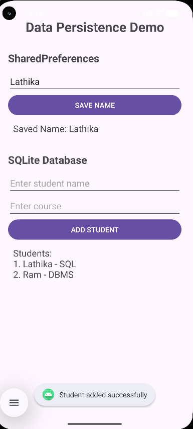

# Data Persistence Demo (Android)
 
## Overview
DataPersistenceDemo is an Android application developed in Kotlin to demonstrate data persistence on an Android device.
 
## Objective
The objective is to demonstrate how an Android application can save and retrieve data so that information can be retained between app interactions or launches.
 
## Technology Stack
- **Platform:** Android
- **Language:** Kotlin
- **IDE:** Android Studio
- **UI:** Android XML layouts
- **Persistence:** Local data persistence (see `DatabaseHelper.kt` and `MainActivity.kt` in the project source)
 
## Project Structure
```text
DataPersistenceDemo/
├── app/
│   └── src/main/
│       ├── java/com/example/datapersistencedemo/
│       │   ├── MainActivity.kt
│       │   └── DatabaseHelper.kt
│       ├── res/layout/activity_main.xml
│       └── AndroidManifest.xml
├── gradle/
├── build.gradle.kts
├── settings.gradle.kts
└── README.md
```
 
## Application Output
The screenshot below shows the output submitted with this project.
 

 
Screenshot URL: https://github.com/Lathika-kathirvel/data-persistence/blob/main/ScreenShort/output.png
 
## How to Run
1. Clone or download this repository.
2. Open the project in Android Studio.
3. Allow Gradle sync to finish.
4. Select an emulator or connect an Android device with USB debugging enabled.
5. Click **Run** to install and launch the app.
 
## Main Source Files
- `MainActivity.kt` — activity entry point and app interaction logic.
- `DatabaseHelper.kt` — helper class for the project's persistence/database logic.
- `activity_main.xml` — layout for the main screen.
- `AndroidManifest.xml` — app declaration and Android configuration.
 
## Repository
https://github.com/Lathika-kathirvel/data-persistence
 
## Conclusion
This project demonstrates an Android app organized with Kotlin source files and XML resources. Refer to the source code in the repository for the exact implementation 
